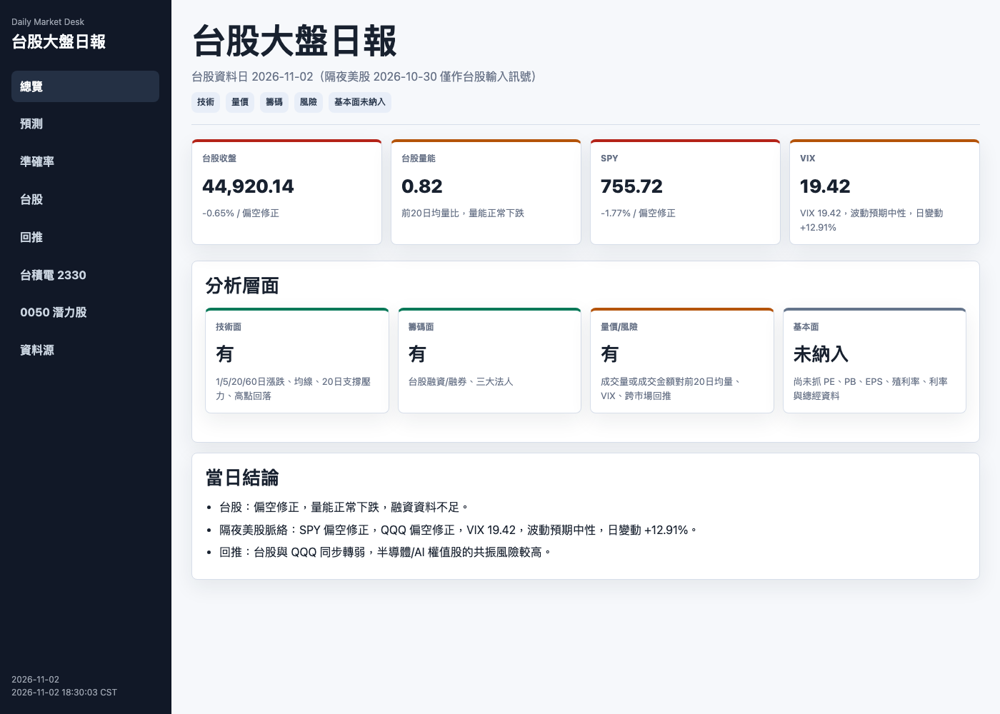

# stock_market — Taiwan Market Daily Desk

A self-hosted pipeline that runs every weekday after the Taiwan close. It pulls public market data, writes a single-page HTML/Markdown report, predicts the **next trading day's direction** for the TAIEX, and later grades its own predictions against what actually happened.

It also retrains its model every evening. A new model is **deployed only if it beats the simplest possible baselines on out-of-sample data**.



> This is a research/learning project. Nothing here is investment advice.

---

## Why this project is interesting

Most "stock prediction" side projects report one impressive accuracy number. This one is built around the opposite question: **how do I know I'm not fooling myself?**

| Problem | What this project does about it |
|---|---|
| Look-ahead bias | Every stored source field carries an `*_asof_taipei` timestamp. A feature can be used only if its data was published before the 18:30 Asia/Taipei decision time (`marketlib/features.py`). |
| One lucky train/test split | `validate.py` runs **rolling-origin validation**: it retrains before each window, scores the days after it, and pools the results. The deploy gate uses this number, not the single split. |
| "70% accuracy!" in a market that is flat 43% of the time | Every metric is reported next to constant baselines: always-up, always-flat, persistence, and class-prior random. A **McNemar test** checks whether the edge over the best baseline is statistically real. |
| Good hit rate with bad probabilities | The gate also requires the model's **Brier score** to beat a constant-probability forecast. |
| Silent model drift | `self_tune.sh` retrains every night, promotes a candidate only if it passes the gate, and commits each promoted model as a version record. |

### Honest current result

These numbers come from the self-tune log on 2026-10-30. The TW model is a two-stage logistic regression with 22 features, trained on 2015-01 → 2026-10.

| Metric | Model | Best constant baseline |
|---|---|---|
| Rolling-origin hit rate (n = 1008, 8 windows) | **0.453** | 0.444 |
| Fixed-split hit rate | 0.471 | 0.429 (always "flat") |
| Brier score | 0.6400 | 0.6474 |
| McNemar p-value vs. best constant | 0.488 | — |

So the model does slightly better than the baselines, but **not significantly better**. On roughly half of the evenings, the gate rejects the retrained candidate. The report states this openly.

---

## What the daily report contains

The report is a single static HTML file (no server, no JS framework). Its sidebar has these sections:

- **Overview**: index close, volume ratio, overnight SPY / QQQ / VIX, and a short conclusion
- **Prediction**: next-day direction (up / flat / down), calibrated probabilities, and a confidence tier
- **Accuracy**: a running scorecard of past predictions vs. actual closes, with a confusion matrix, macro-F1, per-class precision/recall, a price/volume diagnostic backtest, and tagged reasons for each miss
- **Taiwan market**: moving averages, drawdown, margin balance, institutional net buy/sell, and futures open interest
- **Cross-market read**: how the US session is likely to carry into Taiwan
- **TSMC (2330)**: a single-stock readout across several facets
- **0050 screener**: a cross-sectional ranking of the Taiwan 50 constituents
- **Data sources**: how fresh each upstream feed is

The "flat" band adapts to the market. It is half of the 60-day realised daily volatility, clamped to 0.3%–0.9%. Each prediction stores the threshold it used, so later grading stays consistent.

---

## Architecture

```
                 ┌─────────────── weekday 18:30 (cron) ───────────────┐
 TWSE / TAIFEX ─▶│ daily_market_report.py                              │──▶ reports/YYYY-MM-DD.{html,md}
 Nasdaq / Cboe ─▶│   fetch → indicators → model inference → grade past │──▶ data/YYYY-MM-DD.json
 FINRA         ─▶│   predictions → render                              │──▶ data/evaluation_history.json
                 └─────────────────────────────────────────────────────┘

                 ┌─────────────── weekday 20:00 (launchd) ────────────┐
 data/history.db▶│ self_tune.sh → train.py --rolling-windows           │──▶ models/candidate_auto/
  (SQLite, PIT)  │   → deploy gate → promote? → git commit model       │──▶ models/model_tw.json
                 └─────────────────────────────────────────────────────┘

 backfill.py       loads years of point-in-time history into SQLite (request budget, retry, resume)
 refresh_stocks.py refreshes TW50 daily bars without hitting rate limits (resumes via ingest_log)
```

| Module | Responsibility |
|---|---|
| `marketlib/fetchers.py` | Market-level fetchers for TWSE, TAIFEX, Nasdaq, Cboe and FINRA |
| `marketlib/stocks.py` | Per-stock TWSE fetchers and technical indicators. Parsers are pure functions tested with fixtures. |
| `marketlib/store.py` | SQLite schema that records an availability timestamp for every source |
| `marketlib/features.py` | Causal feature engineering and the point-in-time availability rule |
| `marketlib/model.py` | Two-stage logistic model stored as JSON, with isotonic calibration. Inference uses only the standard library. |
| `marketlib/evaluation.py` | Labels, the adaptive flat band, and classification metrics |
| `marketlib/stats.py` | McNemar significance test |
| `marketlib/screener.py` | Cross-sectional scoring across several facets |

**Design choice:** the daily report runs on the **Python standard library only**, so cron can use the system `python3`. numpy and scikit-learn are needed only for offline training and validation.

---

## Getting started

You need Python 3.9+ for the daily report and Python 3.11 for training.

```bash
git clone https://github.com/kavinqq/stock_market.git
cd stock_market

# 1. Daily report (no dependencies)
python3 daily_market_report.py                 # today (Asia/Taipei)
python3 daily_market_report.py --date 2026-10-30
open reports/latest.html

# 2. Training stack (optional)
python3.11 -m venv .venv && source .venv/bin/activate
pip install -r requirements.txt

python backfill.py --start 2015-01-01 --max-requests 500   # resumable; re-run until done
python backfill.py --coverage                               # coverage summary, no network
python train.py --market tw --rolling-windows 8 --out models/candidate
python validate.py --market tw                              # rolling-origin report
```

### Schedule it

```bash
./install_cron.sh   # adds a weekday 18:30 crontab entry for the daily report
```

`launchd/` contains a sample macOS agent that runs `self_tune.sh` on weekdays at 20:00. Before loading it, change the paths inside to match your machine.

### Run the tests

```bash
python -m unittest discover -s tests    # 190 tests; parsers run against fixtures
```

---

## Data sources

| Source | Data |
|---|---|
| TWSE `FMTQIK`, `MI_MARGN`, `BFI82U`, `STOCK_DAY` | Index turnover, margin balance, institutional flows, per-stock daily bars |
| TAIFEX | Foreign and institutional open interest in TX futures |
| Nasdaq historical API | SPY, QQQ, IWM, Nasdaq Composite |
| Cboe | VIX history |
| FINRA | Monthly margin statistics |

All sources are public. The fetchers keep request rates low, using a per-run request budget and backoff. If you fork this project, please keep that behaviour.

---

## Development process

Each feature went through the same steps: a written design spec, then an implementation plan, then test-first tasks. The specs and plans are in `docs/superpowers/specs/` and `docs/superpowers/plans/`, written in Traditional Chinese.

## License

[MIT](LICENSE) © 2026 KuanLin
